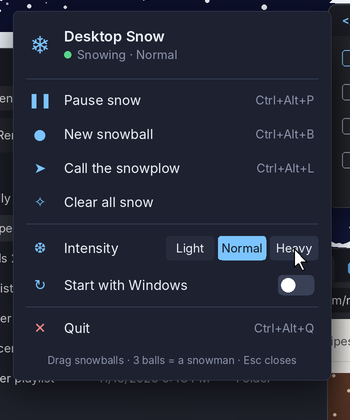

# ❄️ Desktop Snow

**Snow that falls behind your windows, piles up on top of them, and turns into snowmen.**
For Windows 10 and 11 — just download and run.

🎬 <a href="docs/demo.mp4">Watch the full-quality video (MP4, 51 s)</a>

### [⬇️ Download Desktop Snow for Windows](https://snow.tiagoanoliveira.pt/dist/DesktopSnow.exe)

---

## 🚀 Install

1. **[Download `DesktopSnow.exe`](https://snow.tiagoanoliveira.pt/dist/DesktopSnow.exe)** from the latest release.
2. **Double-click it.** It starts snowing. 🎉
   No Python, no installer, nothing else to set up — it's a single executable.

> **First time you run it, Windows shows a warning.** Because the app isn't signed by a paid certificate, SmartScreen says “Windows protected your PC”. This is normal for free, unsigned apps — click **More info → Run anyway**. You only do this once.

## 🎮 Usage

### Mouse
- **Drag** a snowball to move it.
- **Drop it on another one** to stack them. Three snowballs make a snowman.
- **Throw it**: drag quickly and let go mid-motion.
- Your clicks keep working normally in your windows. The snow only catches the mouse when the cursor is right over a snowball or a snowman.
### Shortcuts

| Shortcut | What it does |
|---|---|
| <kbd>Ctrl</kbd> + <kbd>Alt</kbd> + <kbd>S</kbd> | Open / close the menu |
| <kbd>Ctrl</kbd> + <kbd>Alt</kbd> + <kbd>P</kbd> | Pause / resume (hides everything) |
| <kbd>Ctrl</kbd> + <kbd>Alt</kbd> + <kbd>B</kbd> | Create a snowball at the mouse cursor |
| <kbd>Ctrl</kbd> + <kbd>Alt</kbd> + <kbd>L</kbd> | Call the snowplow now |
| <kbd>Ctrl</kbd> + <kbd>Alt</kbd> + <kbd>R</kbd> | Restart (clear everything and start fresh) |
| <kbd>Ctrl</kbd> + <kbd>Alt</kbd> + <kbd>Q</kbd> | Quit |

> 💡 On many European keyboards, <kbd>AltGr</kbd> acts as <kbd>Ctrl</kbd> + <kbd>Alt</kbd>, so <kbd>AltGr</kbd> + <kbd>S</kbd> opens the menu too.

### Menu

<kbd>Ctrl</kbd> + <kbd>Alt</kbd> + <kbd>S</kbd> opens a menu with everything in one place:

- **Pause / resume** the snow
- **New snowball**
- **Call the snowplow**
- **Clear all snow** that has piled up
- **Intensity**: Light, Normal or Heavy (remembered for next time)
- **Start with Windows**: turn automatic start-up on or off
- **Quit**
  Close it with <kbd>Esc</kbd>, a click outside it, or <kbd>Ctrl</kbd> + <kbd>Alt</kbd> + <kbd>S</kbd>.

 

## ✨ Features

- **Snow behind your windows** — flakes only show over the desktop, so they never cover what you're working on.
- **Piles up on top of windows** — snow builds up along the top edge of every window and slides off the sides when a pile gets too steep.
- **Reacts to your windows** — close or minimize a window and the snow on top falls down; shake it hard and some shakes off; drag it gently and the snow rides along.
- **Snowmen** — drag snowballs around, throw them, or stack three into a snowman with a Santa hat, a scarf and a carrot nose.
- **Snowplow** — when too much snow piles up above the taskbar, a snowplow drives by and clears it.
- **Options menu** — adjust the intensity and fall speed, clear the snow, or start with Windows.
- **Instant pause** — hide everything with one shortcut, perfect for screenshots.
## 🔁 Start with Windows

Open the menu and turn on **Start with Windows**. The snow will then start every time you sign in. Click the same switch again to turn it off.

## ❓ Troubleshooting

<b>Windows says it protected my PC and won't run it</b>

That's the SmartScreen warning for unsigned apps, not a virus alert. Click **More info**, then **Run anyway**. You only need to do this the first time.

<b>The snow disappears when I maximize a window</b>

That's by design: the snow always stays behind your windows. With a maximized window, there's no visible desktop.

<b>The snow froze or is acting up</b>

Press <kbd>Ctrl</kbd> + <kbd>Alt</kbd> + <kbd>R</kbd> to restart it — this clears everything and starts fresh without closing the program.

<b>I get “Desktop Snow is already running”</b>

A copy is already open, possibly started with Windows. Press <kbd>Ctrl</kbd> + <kbd>Alt</kbd> + <kbd>S</kbd> to open its menu.

## ⚠️ Limitations

- Works on the **primary monitor** only.
- The warning on first launch can't be removed without a paid code-signing certificate.

## 📄 License

Released under the [MIT License](LICENSE). Copyright © 2026 Tiago Oliveira.
 
---

Made with ❄️ and Python

