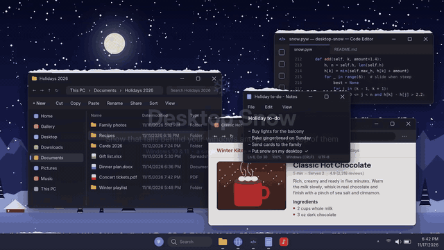

<div align="center">

# ❄️ Desktop Snow

**Snow that falls behind your windows, piles up on top of them, and turns into snowmen.**
For Windows 10 and 11 — a single Python file, nothing to install.




<sub>🎬 <a href="docs/demo.mp4">Watch the full-quality video (MP4, 51 s)</a> · animation rendered from the <code>snow.pyw</code> code on a mock desktop</sub>

<!--
  To make the video play right here in the README:
  1. On GitHub, open README.md and click the pencil (Edit).
  2. Drag docs/demo.mp4 into the editor.
  3. GitHub creates a link like https://github.com/user-attachments/assets/...
  4. Put that link on its own line in place of the  above, then commit.
-->

</div>

---

## ✨ Features

| | |
|---|---|
| 🌨️ **Snow behind your windows** | Flakes only show over the desktop, so they never cover what you're working on. |
| 🏔️ **Piles up on top of windows** | Snow builds up along the top edge of every window and slides off the sides when a pile gets too steep. |
| 🪟 **Reacts to your windows** | Close or minimize a window and the snow on top falls down. Shake it hard and some snow shakes off. Drag it gently and the snow rides along. |
| ⛄ **Snowmen** | Every now and then a snowball forms. Drag it with the mouse, throw it, or stack **3 snowballs** to build a snowman with a Santa hat, a scarf and a carrot nose. |
| 🚜 **Snowplow** | When too much snow piles up above the taskbar, a snowplow drives by and clears it. |
| ⏸️ **Instant pause** | Hide everything with one shortcut — perfect for screenshots and presentations. |
| ⚙️ **Simple menu** | <kbd>Ctrl</kbd> + <kbd>Alt</kbd> + <kbd>S</kbd> opens a menu with every option, so anyone can use it. |

## 🚀 Installation

1. **Install Python** from [python.org](https://www.python.org/downloads/windows/).
   During setup, tick **“Add Python to PATH”**.
2. **Download [`snow.pyw`](snow.pyw)** and save it in a folder where it will stay (for example `Documents\Desktop Snow`).
3. **Double-click `snow.pyw`.** It starts snowing. 🎉

There's nothing else to install. The script only uses what already ships with Python.

## 📦 Build a standalone .exe (optional)

Want to share Desktop Snow with people who don't have Python? Build a single `DesktopSnow.exe` they can just double-click. On a Windows machine with Python installed, run this once in the project folder:

```
pip install pyinstaller
pyinstaller DesktopSnow.spec
```

The finished `DesktopSnow.exe` appears in a new `dist` folder. That one file is all you share — the source stays with you. The build settings live in `DesktopSnow.spec`; to give the `.exe` an icon, add an `.ico` file and uncomment the `icon=` line there.

> **SmartScreen note:** an unsigned `.exe` from an unknown publisher makes Windows SmartScreen show a “Windows protected your PC” warning the first time it runs. That's normal for free, unsigned apps — users click **More info → Run anyway**. Removing the warning for good requires a paid code-signing certificate.

## 🎮 Usage

### Mouse
- **Drag** a snowball to move it.
- **Drop it on another one** to stack them. Three snowballs make a snowman.
- **Throw it**: drag quickly and let go mid-motion.
- Your clicks keep working normally in your windows. The snow only catches the mouse when the cursor is right over a snowball or a snowman.

### Shortcuts

| Shortcut | What it does |
|---|---|
| <kbd>Ctrl</kbd> + <kbd>Alt</kbd> + <kbd>S</kbd> | Open / close the menu |
| <kbd>Ctrl</kbd> + <kbd>Alt</kbd> + <kbd>P</kbd> | Pause / resume (hides everything) |
| <kbd>Ctrl</kbd> + <kbd>Alt</kbd> + <kbd>B</kbd> | Create a snowball at the mouse cursor |
| <kbd>Ctrl</kbd> + <kbd>Alt</kbd> + <kbd>L</kbd> | Call the snowplow now |
| <kbd>Ctrl</kbd> + <kbd>Alt</kbd> + <kbd>R</kbd> | Restart (clear everything and start fresh) |
| <kbd>Ctrl</kbd> + <kbd>Alt</kbd> + <kbd>Q</kbd> | Quit |

> 💡 On many European keyboards, <kbd>AltGr</kbd> acts as <kbd>Ctrl</kbd> + <kbd>Alt</kbd>, so <kbd>AltGr</kbd> + <kbd>S</kbd> opens the menu too.

### Menu


The menu opens next to the cursor and puts everything in one place:

- **Pause / resume** the snow
- **New snowball**
- **Call the snowplow**
- **Clear all snow** that has piled up
- **Intensity**: Light, Normal or Heavy (remembered for next time)
- **Start with Windows**: turn automatic start-up on or off
- **Quit**

Close it with <kbd>Esc</kbd>, a click outside it, or <kbd>Ctrl</kbd> + <kbd>Alt</kbd> + <kbd>S</kbd>.

<br clear="right">

## 🔁 Start with Windows

Open the menu and turn on **Start with Windows**. The snow will then start every time you sign in.

This adds an entry under `HKEY_CURRENT_USER\…\CurrentVersion\Run`, for your user only, with no administrator rights needed. Click the same switch again to turn it off.

> If you previously put a shortcut to `snow.pyw` in your Startup folder (`shell:startup`), delete it. With both in place the snow still only opens once, but you'll see an “already running” notice every time you sign in.

## 🛠️ Configuration

At the top of `snow.pyw` there's a **SETTINGS** section you can change in any text editor:

| Setting | Default | What it controls |
|---|---|---|
| `INTENSITIES` | 110 / 260 / 450 | Number of falling flakes for each intensity level |
| `WIND` | `0.15` | Wind (positive blows right, negative blows left) |
| `MAX_PILE` | `16` | Maximum snow height on top of a window (px) |
| `MAX_GROUND` | `40` | Maximum snow height above the taskbar (px) |
| `PLOW_EVERY_S` | `30` | How often (in seconds) the snowplow checks whether it's needed |
| `PLOW_MIN_AVG` | `4` | How much snow must pile up at the bottom before the snowplow comes out |
| `BALL_EVERY_S` | `12` | How often (in seconds) a snowball may form |
| `MAX_LOOSE_BALLS` | `6` | Maximum number of loose snowballs |
| `SHAKE_PX` | `150` | How fast you have to shake a window to make its snow fall |
| `HOTKEYS` | `S P B L Q` | Shortcut letters (always used with <kbd>Ctrl</kbd> + <kbd>Alt</kbd>) |

## 🧠 How it works

<details>
<summary>Technical details</summary>

- **One transparent window on top of everything.** The script opens a full-screen, always-on-top window with a transparent colour key (`-transparentcolor`) and the `WS_EX_TRANSPARENT` style, which lets clicks pass through to the windows underneath.
- **Clicks only where needed.** Every frame, the script checks where the cursor is. When it's over a snowball or a snowman, it temporarily removes `WS_EX_TRANSPARENT` so you can drag them. As soon as the cursor leaves, clicks pass through again.
- **Finding your windows.** `EnumWindows` returns the visible windows in order, front to back. `DwmGetWindowAttribute(DWMWA_EXTENDED_FRAME_BOUNDS)` gives each window's real size without the invisible borders of Windows 10/11, and `DWMWA_CLOAKED` skips windows hidden on other virtual desktops.
- **Snow “behind” windows.** A flake inside a window's rectangle is hidden. Snow on top of a window only shows on the parts of its top edge that no window in front is covering.
- **Snow piles.** Each window's top edge is split into columns a few pixels wide, each with its own snow height. When a column gets much taller than its neighbour, snow slides sideways, which gives the piles their rounded shape.
- **Simple physics.** Snowballs have gravity, momentum and friction. They land on window tops or on other snowballs and follow the window when it moves. When the window disappears, they fall.
- **Global shortcuts** are read with `GetAsyncKeyState`, with no external libraries.

Everything is drawn with `tkinter` and `ctypes`, which both ship with Python.

</details>

## ❓ Troubleshooting

<details>
<summary><b>I double-click it and nothing happens</b></summary>

`.pyw` files run without a console window, so errors stay hidden. Open a Command Prompt in the file's folder and run `python snow.pyw` to see the error message.

If Windows doesn't know how to open `.pyw` files, right-click the file, choose **Open with → Choose another app** and select `pythonw.exe`.
</details>

<details>
<summary><b>The snow disappears when I maximize a window</b></summary>

That's by design: the snow always stays behind your windows. With a maximized window, there's no visible desktop.
</details>

<details>
<summary><b>The snow froze or is acting up</b></summary>

Press <kbd>Ctrl</kbd> + <kbd>Alt</kbd> + <kbd>R</kbd> to restart it — this clears everything and starts fresh without closing the program. The animation is built to keep running even if a single frame hits an error, so a freeze should be rare; if one happens, Restart gets you going again without the Task Manager.
</details>

<details>
<summary><b>I get “Desktop Snow is already running”</b></summary>

A copy is already open, possibly started with Windows. Press <kbd>Ctrl</kbd> + <kbd>Alt</kbd> + <kbd>S</kbd> to open its menu.
</details>

<details>
<summary><b>A shortcut clashes with another program</b></summary>

Change the letter in `HOTKEYS` at the top of `snow.pyw`.
</details>

## ⚠️ Limitations

- Works on the **primary monitor** only.
- Shape edges aren't anti-aliased (a limitation of transparent `tkinter` windows), so it looks a little more jagged than a native app.
- Some apps with special windows (game overlays, for example) may be skipped or treated as normal windows. If one creates an invisible “ledge”, add its window class to `IGNORE_CLASSES`.

## 📄 License

Released under the [MIT License](LICENSE) — free to use, modify and share, as long as the copyright notice and license text stay included. Replace **YOUR NAME** in `LICENSE` and in the header of `snow.pyw` with your own name.

---

<div align="center">
<sub>Made with ❄️ and Python · inspired by a snow effect for macOS</sub>
</div>
